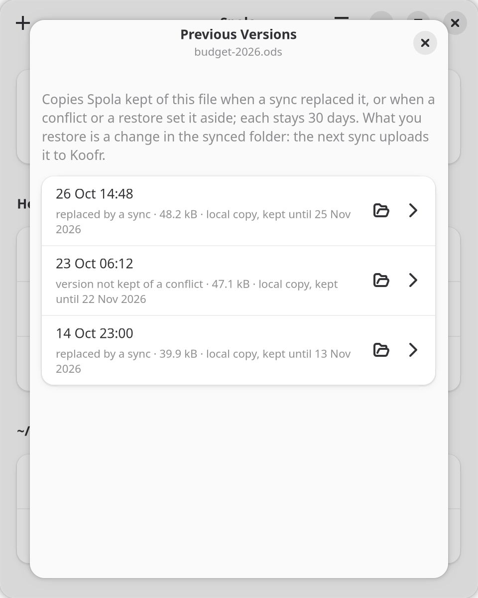

<p align="center">
  <picture>
    <source media="(prefers-color-scheme: dark)" srcset="data/icons/source/spola-darkbg.svg">
    
  </picture>
</p>

<h1 align="center">Spola</h1>

<p align="center">
  Keep your folders in sync with Koofr, on Linux and on Windows.<br>
  <a href="https://spola.neistar.com">spola.neistar.com</a>
</p>

Spola keeps folders on your computer and folders on [Koofr](https://koofr.eu) identical, in both directions, in the background. I wrote it because Koofr's own client never felt at home on my Linux desktop. It is a GTK 4 / libadwaita app built on [rclone](https://rclone.org)'s two-way sync (`rclone bisync`), with a tray icon, the sync status in your file manager, and previous versions of the files a sync replaced. It runs on Linux and, since 0.3.11, on Windows.

The name comes from the weaving shuttle (*spola* in Italian) that carries the thread from one side of the loom to the other; in Italian *fare la spola* means going back and forth.

<p align="center">
  
</p>

What changed, version by version, is in the [changelog](CHANGELOG.md). The design document (in Italian) is [docs/progetto.md](docs/progetto.md). Spola is not affiliated with Koofr.

## Install

### Linux: Flatpak

From [our own Flatpak repository](https://daniel-g-carrasco.github.io/spola/); updates arrive through your software centre (GNOME Software, KDE Discover) or `flatpak update`:

```bash
flatpak install https://daniel-g-carrasco.github.io/spola/spola.flatpakref
```

The GNOME runtime comes from Flathub. The repository is signed; the key's fingerprint is `DFE7 82B9 7EA0 ED33 B6A2  C0F2 BFB2 EC99 7FDB C5B1`. A `.flatpak` bundle is attached to every [release](https://github.com/daniel-g-carrasco/spola/releases) too. The emblems in the file manager need its Python bindings on the host (Fedora: `nautilus-python`, `nemo-python` or `python3-caja`; Margine OS ships the first).

On [Margine OS](https://margine.dev): `ujust install-spola`, and `ujust install-spola migrate` to take over the folders of Koofr Desktop.

### Windows

Every [release](https://github.com/daniel-g-carrasco/spola/releases) has an installer (`spola-setup-…-windows-x64.exe`, for your user only, no administrator needed) and a portable zip. Spola checks for a newer release once a day and offers it; an update is installed only if it carries Spola's own signature. The installer is not signed with a Windows certificate yet, so SmartScreen warns the first time: *More info*, then *Run anyway*.

The installer and the zip have a [minisign](https://jedisct1.github.io/minisign/) signature next to them (`.minisig`). To check one by hand:

```bash
minisign -V -P RWQnErzpJyMPROWGTtWUJRvxMHh8hdPaJU+NhzmlE7SNKlnpn8tGNYH3 -m spola-setup-v0.3.37-windows-x64.exe
```

## Safety first

Spola never writes its own sync engine: rclone bisync does the work, and Spola puts barriers around it.

- **Preview before every big step.** The first alignment of a folder, a repair, and any run that stopped on a safety check are shown as a list of what would happen, and run only after you confirm. Large previews open each kind of change as a tree of folders, with how much of each folder it touches. The list says how much goes each way and whether Koofr has room for it. A preview never holds up the other folders, which keep syncing; a confirmation is worth what its preview showed, and a preview overtaken by a change is prepared again. A folder whose two sides already match aligns without asking.
- **No surprise deletions.** A run that would delete more than 10% of a side (and never more than about 500 files) stops and waits; small folders may lose up to 5 files. A run that would upload many files changed here at once (a snapshot put back, a program rewriting a library) stops the same way.
- **Copies of what a sync replaces.** Files a sync replaces or deletes on this computer are kept for 30 days, and come back from *Previous Versions* (see below). Koofr keeps its own previous versions and its trash of what a sync replaces or deletes there.
- **A move stays a move.** A file moved or renamed on one side is moved the same way on the other (on Koofr, on the server), not deleted and copied again; a big reorganisation still stops and asks first, with the moves listed as moves.
- **Conflicts keep both versions**, with readable names (`report.conflict-local-2026-10-10-1.odt`, `report.conflict-koofr-2026-10-10-1.odt`). You decide one by one, or all at once with a rule (the newer version, this computer's, Koofr's, or both), after a list of what happens to each file; a rule can also run on its own after each sync. The version not kept goes among the folder's kept copies here and to Koofr's trash there.
- **Unmounted drive, replaced folder:** the local folder must still be the one that was paired (a hidden `.spola-root` marker, or the same device and inode with known files in it), otherwise the pair stops before rclone runs. A folder deleted or emptied on one side is not taken as a reason to empty the other: Spola says what happened and offers what helps (Koofr's trash, upload again, copy here again, stop syncing).
- **Verify both sides.** A folder's page compares every file here and on Koofr by size and checksum, changing nothing; every confirmed alignment is followed by a verification of its own.
- **No half-done work.** Files still being written (a download, an export) wait before they are synced. The computer stays awake while a sync runs, and a sleep that comes anyway stops it gracefully and starts it again after. A nearly full disk stops a sync before it starts.
- **Folders that must never be synced** (the home folder itself, `~/.config`, `~/.var`, `~/.ssh`, system folders) are refused. Spola does not sync at all while Koofr Desktop runs on the same computer or is set to start at login: two engines on the same folders lose files. Koofr Desktop on your other computers is fine.
- **Names Koofr refuses** (emoji, names that differ only in upper/lower case) are found before the first run and left out while the rest syncs. Spola suggests names Koofr accepts (`Party.odt`, `Contract (2).odt`) and renames them for you once you confirm.
- **The password stays in the keyring** (Credential Manager on Windows), and reaches rclone only through the environment of the child process, never on a command line.

## Previous versions and deleted files

Spola keeps a copy of every file a sync replaces or deletes on this computer, for 30 days (Preferences, *Keep replaced and deleted files for*). Spola is not a backup program: for older versions of your own edits, use one such as Déjà Dup, or File History on Windows. Right-click a file in the file manager and choose *Previous Versions…*: each copy with its date, size, why it was kept (a newer version came from Koofr, a conflict, a restore) and the day it expires. A copy opens read-only, comes back as a copy next to the file (`report (version of 2026-10-17 12.30).odt`), or replaces the file, which is kept among the copies first, so a replace can be undone. On a folder, *Recently Deleted Files…* lists what was deleted in it: the copies kept here, then what is in Koofr's trash for that folder, with the day it leaves the trash. Spola says before every restore that the next sync uploads it to Koofr.

<p align="center">
  
</p>

A copy is deleted only when its days are over: lowering the days frees the space at once, after saying how much. Each folder's page has a *Kept Copies* section (how many, how much space, since when, the full list with a search), and *Restore from Koofr's Trash* brings back a deletion made on Koofr, with its dates.

## In the window

At the top, what Spola is doing: syncing (with the folder and its progress), up to date, or paused. What waits for you (a first alignment, a confirmation, conflicts, an error) is in a banner above it with a Review button, so a folder waiting for you never hides the others syncing. The same banner says so when less than 10% of your Koofr space is left. While a folder syncs, its files are listed under the status, each with what is happening to it (download, upload, deletion here or on Koofr, conflict) and its progress. Below, the folders grouped by the folder they live in (`~/data`, `~/data/media`...), one row each with its status; the Koofr path is shown only when it is not the same as the one in your home folder.

Each folder has its own page: its status and the action it needs, where it is on both sides, Keep in Sync, a preview of the next sync, Verify, its exclusions (rclone filter syntax, seeded with sensible defaults), conflicts and files Koofr refuses, kept copies, Koofr's trash, the log of its last sync, and removal. In every preview and list a click on a file shows it in the file manager, or its folder on Koofr when it is only there.

Adding a folder: choose it on this computer, then the folder on Koofr. Spola suggests the one in the same place (`~/data/work` and `/data/work`) or with the same name, and lets you browse your Koofr folders one level at a time, or make a new one; folders already synced cannot be chosen. The first alignment is shown as a preview before anything is copied. Coming from Koofr Desktop, *Import from Koofr Desktop* in the menu takes its folders over in one go.

The tray icon is in the panel's own colour, like the panel's other icons: its shape says the state (arrows while syncing, a mark when something needs you, a cross on errors). Hovering it shows what is syncing and how far along it is, and so does the top of its menu, followed by the files being transferred and the five last synced: a click shows the file in Files.

Preferences: account, what to do when a file changes on both sides (ask, keep the newer version, keep both; each folder can have its own rule, also "this computer's" or "Koofr's"), pause on metered networks and in power saver mode, keep the computer awake during a sync, speed limits, start at login, the tray icon, the file manager integration, how many days copies are kept, the language of the conflict copies' names; on Windows also the status in File Explorer and the update check. *About* has a troubleshooting page (versions, paths, every folder's state and last outcome, the room logs and copies take) with a Save button.

<p align="center">
  
</p>

## In the file manager

Preferences has a switch, *Show sync status in the file manager*. Spola sets up every file manager you have used (they leave their folders behind on the first start; one installed later is picked up the next time Spola starts), for your user only, and removes only what it wrote:

| File manager | Emblems | Koofr menu | What Spola installs |
|---|---|---|---|
| Files (Nautilus) | yes | yes | a nautilus-python extension |
| Nemo | yes | yes | the same extension, for nemo-python |
| Caja | yes | yes | the same extension, for python3-caja |
| Dolphin | with the plugin below | yes | a service menu |
| Thunar | no (Thunar has no emblem API for extensions) | yes | custom actions in `uca.xml` |

The emblems are synced, syncing, changed here and waiting, error, conflict, left out. The menu gives *Sync Now with Koofr*, *Open on Koofr*, *Share…*, *Previous Versions…* on a file that has kept copies and *Recently Deleted Files…* on a folder. The extension only ever reads from a cache and asks Spola, over D-Bus, once per folder, so the file manager stays as fast as it is; with Spola not running it does nothing. The Python bindings must be installed (Fedora: `nautilus-python`, `nemo-python`, `python3-caja`), and the file manager restarted (`nautilus -q`, `nemo -q`, `caja -q`).

*Share…* opens the same sharing window in every file manager. Opening it only reads the current settings. Create a public link explicitly, then copy it, manage its password and expiration, hide its download button, or revoke it. The window shows passwords required by Koofr and explains who can open the link; copying preserves the existing settings. Hiding a download button does not prevent saving or recording content. Available options depend on the Koofr account's plan.

Sharing respects the folder's ordered exclusions, including `+`/`-` rules, anchored paths and `*`, `**`, `?` patterns. If advanced rclone filters use character classes, alternatives, escapes or regular expressions, Spola asks you to manage sharing on Koofr instead of guessing whether the item is synced.

The same window lets you invite people by email, change their viewing, editing or custom permissions, and remove their access. Invitations require a Koofr account; editing a folder includes adding, replacing and deleting its contents. A file shared individually is read-only. Access inherited from parent folders is shown with its source and managed at that parent. Revoking one link or removing one invitation does not revoke other access routes.

Dolphin's overlay icons need a small KDE plugin built on your system: an app cannot install it for you. It takes three commands, see [extensions/dolphin](extensions/dolphin/README.md).

<p align="center">
  
</p>

The D-Bus interface (`io.github.daniel_g_carrasco.spola.Sync1` at `/io/github/daniel_g_carrasco/spola/Sync`, version 3) is there for any other file manager: states per folder, states per file, sync now, web link, sharing dialog (`Share`), previous versions and deleted files (list, restore, show), signals when states or kept copies change; the actions take a `file://` URI or a plain path. Legacy `ShowShareLink` opens the sharing dialog. `CreateShareLink` only returns an existing active link without a password; otherwise it opens the dialog and returns an error requiring an explicit action, without publishing anything.

## On Windows

The same window and the same safety checks. The status sits in the notification area, in colour, and File Explorer shows each synced folder's status as cloud apps do, each file turning green when copied (it can be turned off in Preferences). Explorer's menu on a synced folder or file gives *Open on Koofr*, *Share…*, *Previous Versions…* and *Recently Deleted Files…*. `spola forget-windows` takes Spola's entries out of Explorer (the uninstaller does it).

## Noctalia

For the [Noctalia](https://noctalia.dev) shell there is a plugin in [noctalia/spola](noctalia/spola/README.md): a cloud in the bar with the sync status, a panel with every folder and its progress, a control-centre tile that pauses and resumes everything, launcher results behind `/spola`. It reads `status.json`, which Spola keeps current in its state folder for any desktop widget. With the plugin in the bar, the tray icon can be switched off.

## From source

Needs Python 3.11 or newer, PyGObject, GTK 4, libadwaita 1.6 or newer, libsecret and rclone 1.71 or newer.

```bash
python3 tools/compile_po.py          # translations (optional)
bin/spola                            # the app
bin/spola --background               # start in the tray only
```

You sign in with your Koofr e-mail and an **app password** (Koofr account settings, *Passwords*): Koofr does not accept the main password from other apps.

## Command line

```bash
spola login
spola add ~/scratch/spola-test /spola-test
spola status
spola preview spola-test
spola align spola-test           # first alignment: preview, then asks
spola sync spola-test [--dry-run] [--force]
spola verify spola-test          # compare both sides, changing nothing
spola repair spola-test          # after a critical error: preview, then asks
spola remove spola-test          # forget the pair; no file is deleted
spola import-koofr-desktop       # take over Koofr Desktop's folders
```

The command line refuses to sync or preview a folder while the app runs: the app does it.

## Development

```bash
python3 -m unittest discover -s tests     # all tests; the bisync ones need rclone
tools/gui_smoke.sh /tmp/spola-gui          # the window on a Broadway display, screenshot in /tmp/spola-gui
tools/screenshots.sh                       # the screenshots of this README and of the site
tools/file_managers_smoke.sh /tmp/spola-fm # Files, Nemo, Caja, Dolphin, Thunar for real, in a container
python3 tools/make_icons.py                # regenerate the icons
python3 tools/compile_po.py --update       # refresh po/spola.pot and po/*.po
```

`SPOLA_DEV_REMOTE=/some/folder` turns the Koofr side into a local folder, so every flow of the app and of the command line can be tried without an account; `SPOLA_DEV_BWLIMIT=300k` slows runs down to watch them. The Windows build (MSYS2, PyInstaller, Inno Setup) runs in the CI, `.github/workflows/windows.yml`.

## License

MIT
