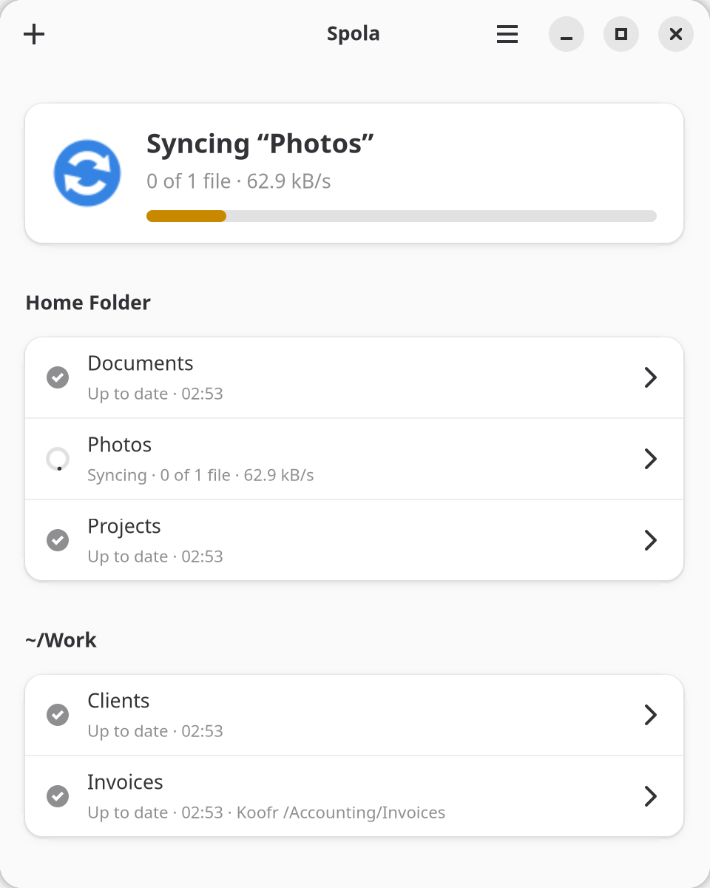
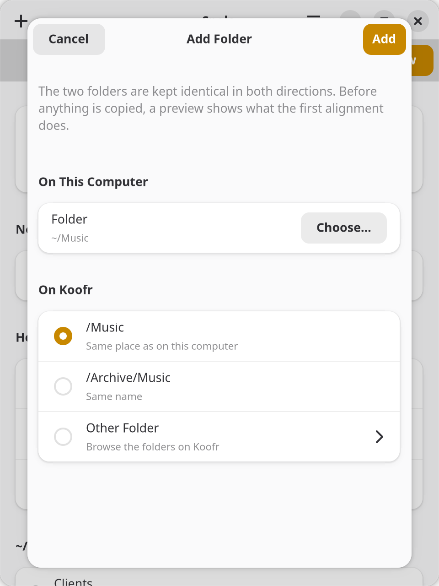
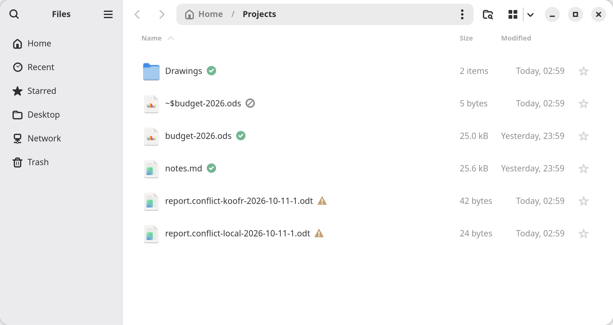

<p align="center">
  <picture>
    <source media="(prefers-color-scheme: dark)" srcset="data/icons/source/spola-darkbg.svg">
    
  </picture>
</p>

<h1 align="center">Spola</h1>

<p align="center">
  Keep your folders in sync with Koofr, on GNOME.<br>
  <a href="https://spola.neistar.com">spola.neistar.com</a>
</p>

Spola keeps folders on your computer and folders on [Koofr](https://koofr.eu) identical, in both directions, in the background. I wrote it because Koofr's own client never felt at home on GNOME. It is a GTK 4 / libadwaita app built on [rclone](https://rclone.org)'s two-way sync (`rclone bisync`), with a tray icon and, later, Nautilus emblems.

The name comes from the weaving shuttle (*spola* in Italian) that carries the thread from one side of the loom to the other; in Italian *fare la spola* means going back and forth.

<p align="center">
  
</p>

The design document (in Italian) is [docs/progetto.md](docs/progetto.md). Spola is not affiliated with Koofr.

## Install

### Flatpak

From [our own Flatpak repository](https://daniel-g-carrasco.github.io/spola/); updates arrive through GNOME Software:

```bash
flatpak install https://daniel-g-carrasco.github.io/spola/spola.flatpakref
```

The GNOME runtime comes from Flathub. The repository is signed; the key's fingerprint is `DFE7 82B9 7EA0 ED33 B6A2  C0F2 BFB2 EC99 7FDB C5B1`. A `.flatpak` bundle is attached to every [release](https://github.com/daniel-g-carrasco/spola/releases) too. The emblems in the file manager need its Python bindings on the host (Fedora: `nautilus-python`, `nemo-python` or `python3-caja`; Margine OS ships the first).

On [Margine OS](https://margine.dev): `ujust install-spola`, and `ujust install-spola migrate` to take over the folders of Koofr Desktop.

## Safety first

Spola never writes its own sync engine: rclone bisync does the work, and Spola puts barriers around it.

- **Preview before every big step.** The first alignment of a folder, a repair, and any run that stopped on a safety check are shown as a list of what would happen, and run only after you confirm. The list says how much goes each way and whether Koofr has room for it. A preview never holds up the other folders, which keep syncing; you can close it and it goes on (a notification says when it is ready), and a folder waiting for you has its preview prepared ahead, so Review opens it at once.
- **No surprise deletions.** A run that would delete more than 10% of a side stops and waits (small folders may lose up to 5 files). Files deleted or replaced on this computer go to a local backup, kept 30 days.
- **A move stays a move.** A file moved or renamed on one side is moved the same way on the other (on Koofr, on the server), not deleted and copied again; a big reorganisation still stops and asks first, with the moves listed as moves.
- **Conflicts keep both versions**, with readable names (`report.conflict-local-2026-10-10-1.odt`, `report.conflict-koofr-2026-10-10-1.odt`). You decide one by one, or all at once with a rule (the newer version, this computer's, Koofr's, or both), after a list of what happens to each file; a rule can also run on its own after each sync. The version not kept goes to the wastebasket here and to Koofr's trash.
- **Unmounted drive, replaced folder:** the local folder must still be the one that was paired (a hidden `.spola-root` marker, or the same device and inode with known files in it), otherwise the pair stops before rclone runs.
- **Folders that must never be synced** (the home folder itself, `~/.config`, `~/.var`, `~/.ssh`, system folders) are refused. Spola does not sync at all while Koofr Desktop runs on the same computer or is set to start at login: two engines on the same folders lose files. Koofr Desktop on your other computers is fine.
- **Names Koofr refuses** (emoji, names that differ only in upper/lower case) are found before the first run and left out while the rest syncs. Spola suggests names Koofr accepts (`Party.odt`, `Contract (2).odt`) and renames them for you once you confirm.
- **The password stays in the keyring**, and reaches rclone only through the environment of the child process, never on a command line.

## In the window

At the top, what Spola is doing: syncing (with the folder and its progress), up to date, or paused. What waits for you (a first alignment, a confirmation, conflicts, an error) is in a banner above it with a Review button, so a folder waiting for you never hides the others syncing. The same banner says so when less than 10% of your Koofr space is left. While a folder syncs, its files are listed under the status, each with what is happening to it (download, upload, deletion here or on Koofr, conflict) and its progress. Below, the folders grouped by the folder they live in (`~/data`, `~/data/media`...), one row each with its status; the Koofr path is shown only when it is not the same as the one in your home folder. Each folder has its own page: its status and the action it needs, where it is on both sides, Keep in Sync, a preview of the next sync, its exclusions (rclone filter syntax, seeded with sensible defaults), conflicts and files Koofr refuses, and removal. Conflicts are resolved from there: keep this computer's version, Koofr's, or both under readable names, one by one or all together with a rule; the discarded one goes to the wastebasket. In every preview and list a click on a file shows it in the file manager, or its folder on Koofr when it is only there.

Adding a folder: choose it on this computer, then the folder on Koofr. Spola suggests the one in the same place (`~/data/work` and `/data/work`) or with the same name, and lets you browse your Koofr folders one level at a time, or make a new one; folders already synced cannot be chosen. The first alignment is shown as a preview before anything is copied.

The tray icon stays in the panel's colour while everything is up to date or paused, turns blue while syncing, orange when something needs you and red on errors. Hovering it shows what is syncing and how far along it is, and so does the top of its menu, followed by the files being transferred and the five last synced: a click shows the file in Files.

Preferences: account, what to do when a file changes on both sides (ask, keep the newer version, keep both; each folder can have its own rule, also "this computer's" or "Koofr's"), pause on metered networks (a sync started on its own stops when the network becomes metered, and starts again when it no longer is) and in power saver mode, speed limits, start at login, the Files integration, backup retention, language of the conflict copies' names.

<p align="center">
  
</p>

## In the file manager

Preferences has a switch, *Show sync status in the file manager*. Spola sets up every file manager you have used (they leave their folders behind on the first start; one installed later is picked up the next time Spola starts), for your user only, and removes only what it wrote:

| File manager | Emblems | Koofr menu | What Spola installs |
|---|---|---|---|
| Files (Nautilus) | yes | yes | a nautilus-python extension |
| Nemo | yes | yes | the same extension, for nemo-python |
| Caja | yes | yes | the same extension, for python3-caja |
| Dolphin | with the plugin below | yes | a service menu |
| Thunar | no (Thunar has no emblem API for extensions) | yes | three custom actions in `uca.xml` |

The emblems are synced, syncing, changed here and waiting, error, conflict, left out. The menu gives *Sync Now with Koofr*, *Open on Koofr* and the share link (copied in Files, Nemo and Caja; shown by Spola with a Copy button in Dolphin and Thunar, whose menus can only run a command). The extension only ever reads from a cache and asks Spola, over D-Bus, once per folder, so the file manager stays as fast as it is; with Spola not running it does nothing. The Python bindings must be installed (Fedora: `nautilus-python`, `nemo-python`, `python3-caja`), and the file manager restarted (`nautilus -q`, `nemo -q`, `caja -q`).

Dolphin's overlay icons need a small KDE plugin built on your system: an app cannot install it for you. It takes three commands, see [extensions/dolphin](extensions/dolphin/README.md).

<p align="center">
  
</p>

The D-Bus interface (`io.github.daniel_g_carrasco.spola.Sync1` at `/io/github/daniel_g_carrasco/spola/Sync`) is there for any other file manager: states per folder, states per file, sync now, web link, share link, signals when states change; the actions take a `file://` URI or a plain path.

### From source

Needs Python 3.11 or newer, PyGObject, GTK 4, libadwaita 1.6 or newer, libsecret and rclone 1.71 or newer.

```bash
python3 tools/compile_po.py          # translations (optional)
bin/spola                            # the app
bin/spola --background               # start in the tray only
```

You sign in with your Koofr e-mail and an **app password** (Koofr account settings, *Passwords*): Koofr does not accept the main password from other apps.

## Command line

```bash
spola login
spola add ~/scratch/spola-test /spola-test
spola status
spola preview spola-test
spola align spola-test           # first alignment: preview, then asks
spola sync spola-test [--dry-run] [--force]
spola repair spola-test          # after a critical error: preview, then asks
```

## Development

```bash
python3 -m unittest discover -s tests     # all tests; the bisync ones need rclone
tools/gui_smoke.sh /tmp/spola-gui          # the window on a Broadway display, screenshot in /tmp/spola-gui
tools/file_managers_smoke.sh /tmp/spola-fm # Files, Nemo, Caja, Dolphin, Thunar for real, in a container
python3 tools/make_icons.py                # regenerate the icons
python3 tools/compile_po.py --update       # refresh po/spola.pot and po/*.po
```

`SPOLA_DEV_REMOTE=/some/folder` turns the Koofr side into a local folder, so every flow of the app and of the command line can be tried without an account; `SPOLA_DEV_BWLIMIT=300k` slows runs down to watch them.

## License

MIT
